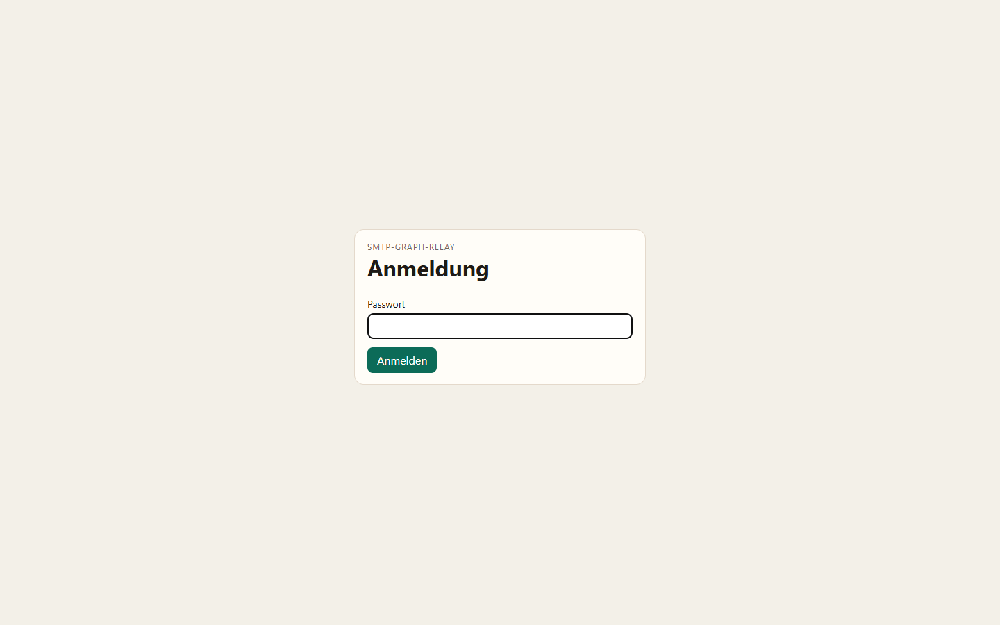
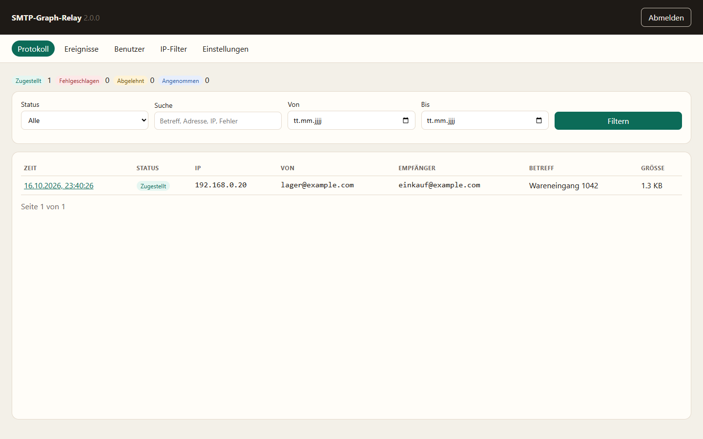
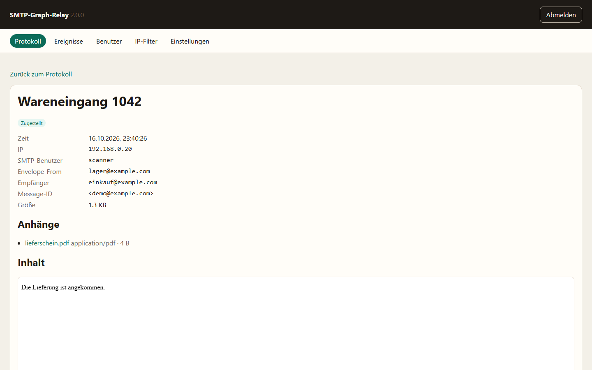
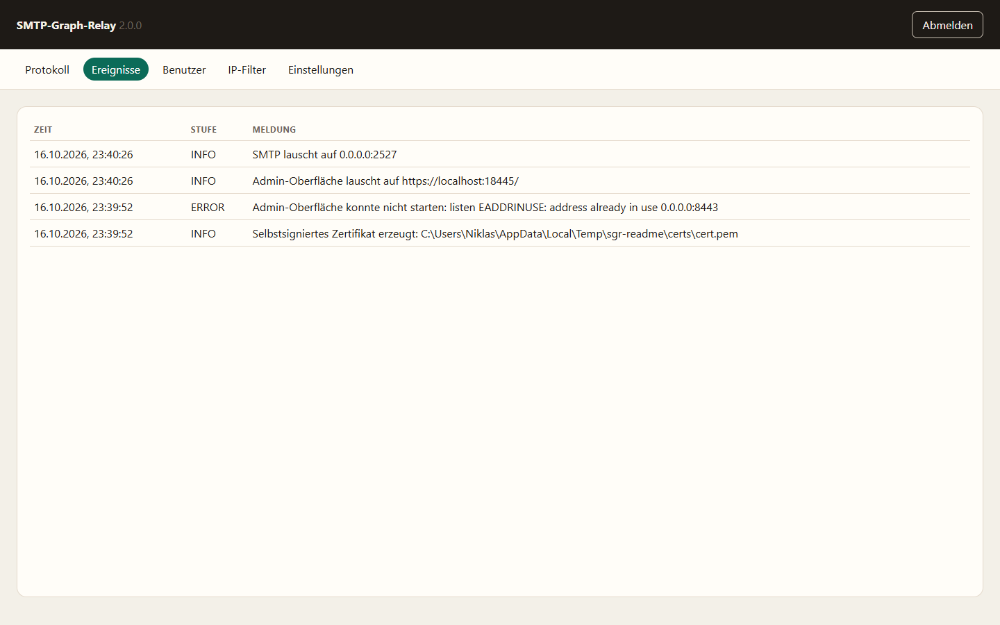
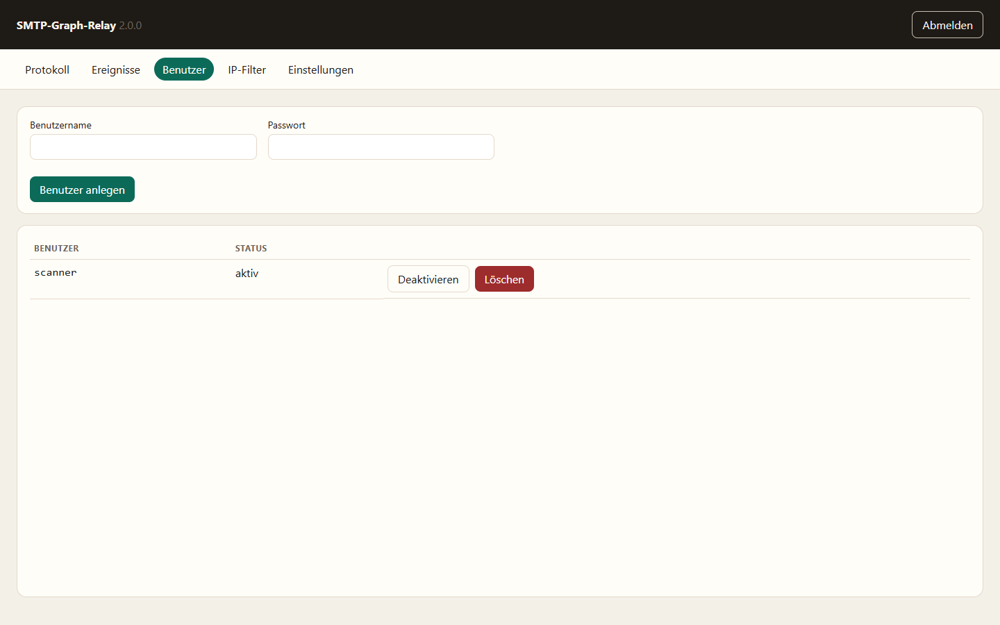
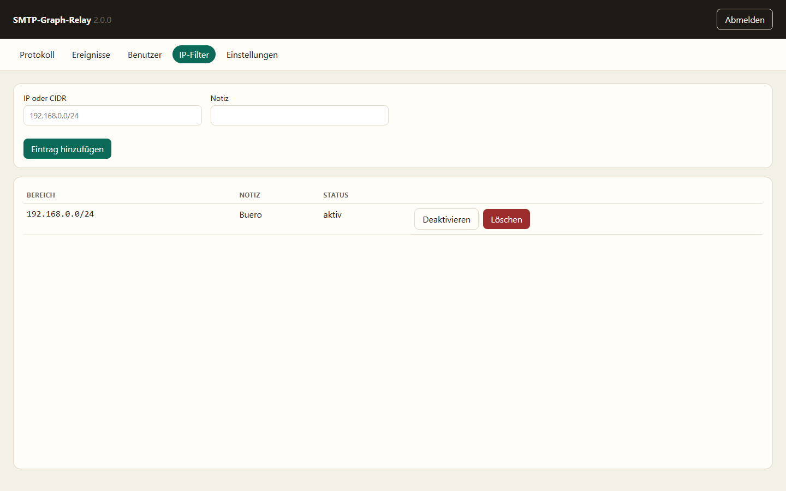
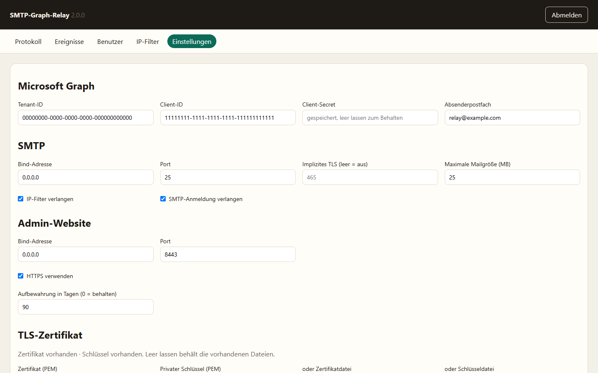

# SMTP-Graph-Relay

SMTP-Graph-Relay nimmt E-Mails per SMTP an und stellt sie über die Microsoft Graph API zu. Konfiguration, Systemereignisse und der vollständige Mailinhalt inklusive Anhängen liegen in einer SQLite-Datenbank. Eine eingebaute Website zeigt das Protokoll und die Einstellungen.

## Funktionen

- SMTP mit optionalem IP-Filter und optionaler Anmeldung per Benutzername und Passwort. Beide Prüfungen lassen sich unabhängig einschalten. Sind beide aus, nimmt der Server jede Verbindung an und die Website warnt vor einem offenen Relay.
- STARTTLS, sobald ein Zertifikat hinterlegt ist. Optional ein zweiter Port für implizites TLS, zum Beispiel 465.
- Weiterleitung über Microsoft Graph. Zugestellt wird an die Empfänger aus dem SMTP-Envelope. CC bleibt erhalten, zusätzliche Envelope-Empfänger gehen als BCC mit.
- Website für Protokoll, Mailinhalt, Anhänge, SMTP-Benutzer, IP-Filter und Einstellungen.
- HTTPS ist standardmäßig aktiv. Ein selbstsigniertes Zertifikat wird beim ersten Start erzeugt. HTTP nur, wenn HTTPS in den Einstellungen ausgeschaltet wird.
- Aufbewahrung standardmäßig 90 Tage. `0` behält Mails und Systemereignisse.

## Datenverzeichnis

Die EXE schreibt nicht in sich selbst. SQLite und Zertifikate sind normale Dateien neben dem Programm.

Liegt die Datei zum Beispiel unter `C:\Apps\SMTP-Graph-Relay\SMTP-Relay.exe`, entstehen:

```text
C:\Apps\SMTP-Graph-Relay\data\relay.sqlite
C:\Apps\SMTP-Graph-Relay\data\certs\cert.pem
C:\Apps\SMTP-Graph-Relay\data\certs\key.pem
```

Beim Start mit `node` gilt dasselbe relativ zum Arbeitsverzeichnis, weil `node.exe` nicht der Installationsordner ist. Ein Windows-Dienst, der `node dist\index.js` startet, braucht deshalb den Installationsordner als Startverzeichnis. Die EXE findet ihre Daten immer neben sich, unabhängig vom Startverzeichnis.

`DATABASE_PATH` setzt den Pfad der Datenbankdatei. Relative Pfade gelten ab dem Programmordner. Zertifikate liegen dann im Unterordner `certs` neben dieser Datei.

`ADMIN_PASSWORD` setzt das Passwort der Website beim Start. Die Variable danach entfernen, sonst wird ein in der Website geändertes Passwort beim nächsten Start wieder überschrieben.

Eine `.env` im Programmordner wird beim ersten Start einmal importiert. Platzhalter wie `your_tenant_id_here` werden ausgelassen. Danach gilt nur noch die Datenbank.

## Voraussetzungen

- Node.js 22.13 oder neuer, wenn die Anwendung nicht als EXE läuft
- Eine Azure-App mit der Anwendungsberechtigung `Mail.Send` und erteilter Administratorzustimmung

## Start

```text
npm install
npm start
```

Beim ersten Start steht das einmalige Admin-Passwort in der Konsole. Die Website ist unter `https://localhost:8443/` erreichbar und lauscht auf allen Schnittstellen. Der Browser warnt beim selbstsignierten Zertifikat, bis ihm vertraut wird.

SMTP lauscht standardmäßig auf Port 25. Schlägt das Binden fehl, läuft die Website trotzdem. Den Port dann in den Einstellungen ändern.

## Website

- Protokoll mit Filter nach Status, Zeitraum und Text. Die Detailseite zeigt Metadaten, Text, HTML in einer Sandbox und die Anhänge.
- SMTP-Benutzer für die optionale Anmeldung. Passwörter werden nur als Hash gespeichert.
- IP-Filter für einzelne Adressen oder CIDR-Bereiche.
- Einstellungen für Graph, Ports, TLS, Aufbewahrung und das Admin-Passwort.

Leere Secret- und Passwortfelder bleiben unverändert. Ein neues Zertifikat kann als PEM eingefügt, als Datei hochgeladen oder selbstsigniert erzeugt werden.

Sind IP-Filter und Anmeldung beide aus, erscheint eine Warnung. Anmeldung ohne TLS ebenfalls, weil das Passwort dann unverschlüsselt über die Leitung geht.

### Anmeldung



### Protokoll



### Mail



### Ereignisse



### SMTP-Benutzer



### IP-Filter



### Einstellungen



## Azure-App

1. Im [Azure-Portal](https://portal.azure.com/) unter App-Registrierungen eine neue Registrierung anlegen.
2. Anwendungs-ID (Client) und Verzeichnis-ID (Tenant) von der Übersicht notieren.
3. Unter Zertifikate & Geheimnisse ein Clientgeheimnis erstellen.
4. Unter API-Berechtigungen `Mail.Send` als Anwendungsberechtigung hinzufügen und die Administratorzustimmung erteilen.

Diese drei Werte und das Postfach, über das gesendet wird, gehören in die Website unter Einstellungen. Das Postfach muss in dem Tenant existieren. Graph sendet immer als dieses Postfach, nicht als die Adresse aus `MAIL FROM`.

## EXE bauen

```text
npm run package
```

Das erzeugt `SMTP-Relay.exe` im Projektordner. Dafür werden der TypeScript-Build, ein einzelnes JavaScript-Bundle und die Single-Executable-Funktion von Node verwendet. Auf dem Zielrechner ist keine Node-Installation nötig. Die Daten liegen neben der EXE.

Ein Push auf `main` startet den Workflow [Release](.github/workflows/release.yml). Er baut die EXE und legt sie im GitHub-Release `latest` ab:

```text
https://github.com/TerhorstIO/SMTP-Graph-Relay/releases/latest/download/SMTP-Relay.exe
```

## Windows-Dienst

Mit [NSSM](https://nssm.cc/download):

```text
nssm.exe install SMTP-Graph-Relay
```

- Pfad: `SMTP-Relay.exe` oder `node.exe`
- Startverzeichnis bei `node.exe`: der Ordner mit `dist\index.js`
- Argumente bei Node: `C:\Pfad\dist\index.js`
- Bei der EXE sind keine Argumente nötig. `DATABASE_PATH` und `ADMIN_PASSWORD` können als Umgebungsvariablen gesetzt werden.

```text
nssm.exe start SMTP-Graph-Relay
```

## Entwicklung

```text
npm install
npm run build
node dist/index.js
```

`npm start` baut vor dem Start neu. Der TypeScript-Compiler ist `tsc`.
